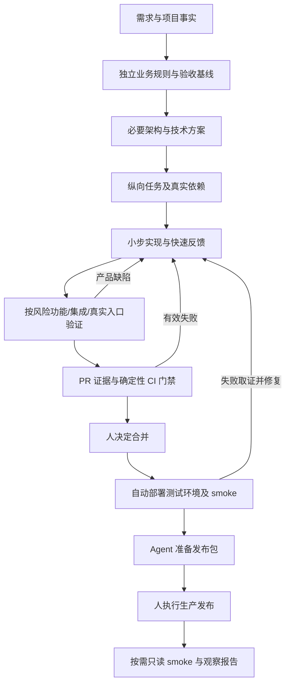
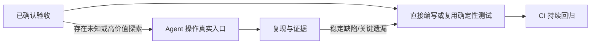

# AI 研发全流程 Skills 重设计方案（v3，统一实施基线）

- 初稿日期：2026-10-13；合并修订：2026-10-14
- 本轮执行：十二项确认名称的源码迁移、四模块对齐、共享产物契约、隔离发布/样例协议验证；用户修改优先，其余采用方案建议（2026-10-14）
- 状态：Antigravity 的初稿已按本基线对齐，十二项源码名称已迁移，隔离发布与样例协议验证通过；Codex、Claude Code、Antigravity、Gemini 与本仓库 design 已授权发布并检查通过；独立 Agent 行为评估及业务试点尚未执行
- 已确认边界：自动化覆盖到测试环境自动部署；代码合并与生产发布由人执行；暂不选业务试点，先设计并验证流程；`verify-<app>` 归目标项目所有，随产品代码提交
- 输入：九阶段研发需求、已读取的「提炼推文中的 AI 开发流程」任务、当前 ai-skills 仓库、Opus 初稿及用户已同意的比较修订意见
- 上游阅读记录：Matt Pocock `49dd158`、Cursor pstack `1b6d44f`；引入源码前仍需核对完整提交、来源与许可证

## 1. 推荐架构

采用四个核心模块：`dev`、`to-spec`、`verify-change`、`setup-verification`，组合目标项目维护的 `verify-<app>` 与现有条件专项。整体方法吸收 Matt 的需求交接与纵向任务切片、pstack 的真实验证与结构化纠错，普通规划、编码、测试运行和代码审查继续使用宿主能力。

| 模块 | 职责 | 边界 |
| --- | --- | --- |
| `dev` | 根据风险选择路径，复用阶段结果，检查交付缺口 | 轻量显式入口，不重写 Agent 调度系统，不为小任务增加仪式 |
| `to-spec` | 技术方案、独立业务判据、验收矩阵、测试缝、任务及依赖 | 已明确需求不重新访谈，已有契约不重复生成 |
| `verify-change` | 根据变更选择验证、处理失败、维护回归并输出证据 | 按风险执行，不固定每项变更都跑所有层和独立评审 |
| `setup-verification` | 生成和维护项目实际运行协议与功能地图 | 复用项目设施，交付前实际执行，自身不代替测试框架 |
| `verify-<app>` | 项目启动、数据、操作、观察、证据、清理及环境模式 | 项目自有，不进入中央 catalog，随产品变更演进 |

`encode-lessons` 暂缓新增。遇到重复失误，先用宿主完成复盘，将结论落实为结构、类型、lint、CI 或行为测试；确有独立复用需求和证据后再拆 skill。

本表是职责设计，不是平行安装清单；受管 skill 的名称、状态、scope、bundle 与依赖仍以 `config/skills.tsv` 为唯一事实源。四个草稿现已登记在可选 `flow` bundle；登记和文件存在不等于已发布或通过行为验证。

### 1.1 四个新模块为什么存在

这四个模块是交付能力的四个切入点，不是每个任务必须依次调用的四步。当前源码名称为 `dev`、`to-spec`、`verify-change`、`setup-verification`；全部命名已按 §7.6 定稿。

| 当前草稿 / 推荐名 | 用户意图与输入 | 输出 | 独立存在的理由 | 与宿主及相邻模块的边界 |
| --- | --- | --- | --- | --- |
| **`dev`** | 希望完成一个研发交付任务；输入目标、项目事实、范围、授权和已有阶段结果 | 最短适用路径、复用的决定、缺失证据及交付状态 | 给团队一个容易记忆的入口，减少跨阶段丢失验收与交接条件 | 单任务执行仍由宿主完成；不重写 Agent loop、不接管人工合并和生产部署；简单工作无需该入口 |
| **`to-spec`** | 需求基本明确，需要能交接的技术与验收契约 | 目标/非目标、必要架构、业务规则/AC、测试缝、切片和依赖 | 把「正确答案是什么」先于实现固定，并使另一位成员/新会话能继续 | 不重新进行需求访谈，不替代所有原生规划；已有有效 spec 时只补实际缺口 |
| **`verify-change` 保留** | 已有变更，需要证明满足验收；输入 AC、差异范围、目标版本和环境 | 相关验证结果、失败归因、回归变更、证据与覆盖缺口 | 统一需求到证据的对应关系，避免只凭编译、局部测试或模型自述宣布完成 | 不提供每个项目的启动知识，不等于代码审查，不默认全层测试或 TDD；普通快速验证仍由宿主处理 |
| **`setup-verification`** | 项目缺少或失去可用自测入口，需要建立或更新它 | 项目自有 `verify-<app>`、功能地图和必要工具，附实跑证明 | 不同项目的真实命令、账号、数据、观察和清理规则无法从通用模型知识获得 | 建立/维护能力，不对每个变更重复生成；保留 create/maintain 两种模式，名称不暗示工具只做首次安装 |

项目自有 **`verify-<app>`** 是生成器的产物与项目事实入口，负责实际运行协议；它不是第五个中央通用流程 skill。名称中的 `<app>` 换成项目稳定标识，例如 `verify-boss`，不包含时间、模型名或试验版本。

新模块要证明的收益是减少交接遗漏、提供有效判据和可复跑证据。固定格式和专项判断是候选复用价值，不保证比原生能力更好；只有走查和试点发现实际收益后，才把它们作为团队默认能力。

## 2. 设计原则与来源选择

| 来源 | 保留的方法 | 本地裁剪 |
| --- | --- | --- |
| Matt | 需求收敛、spec、纵向切片与阻塞边、需求/代码双轴审查、复盘 | 不强制每次访谈、TDD、独立子代理或新会话；不绑定单一 issue tracker |
| pstack | Launch/Doctor/Drive/Evidence/Cleanup、功能地图、验证自测、证据优于绿灯、结构化纠错 | 不整体启用 poteto-mode，不默认多模型面板、全量 live 巡检或高推理预算 |
| 推文提炼任务 | 准确上下文、澄清到足以实施、小改动、业务规则到证据的对应关系 | 不采用全面禁止 AI 写测试；不把作者个人提效陈述当团队验证 |
| 现有 ai-skills | 需求、领域语义、疑难排障、跨端契约、数据库与 UI 专项 | 普通研发能力交给宿主，避免重复包装 |

流程新增价值集中于稳定的交接契约、项目运行事实和验证判断。模型更强不意味着这些事实自动存在，也不意味着要保留所有通用工程提示。

测试要同时补齐：独立判据、真实驱动、可检查证据、可重复回归及维护责任。AI 探索帮助发现未知问题，确定性断言负责重复检验已知要求；两者可以独立开展并互相补充。

## 3. 主流程与阶段交付

流程表达责任与依赖，局部 CI 反馈可从实现阶段持续运行。每个阶段不必单独生成文档；已有 spec、任务、PR 和流水线可承载所需信息。

| 阶段 | 必要产物 | 选择原则 |
| --- | --- | --- |
| 需求讨论 | 目标、非目标、不能改变的行为、验收来源 | 只询问会改变目标、范围或预期的缺口 |
| 架构设计 | 状态归属、模块边界、契约与必要取舍 | 单纯实现已有方向时直接复用；难回退决定才考虑 ADR |
| 技术方案 | 实现方法、测试缝、依赖、兼容与恢复 | 同时说明如何验证，不要求所有方案遍历所有维度 |
| 任务拆解 | 可独立验证的行为切片及阻塞边 | 能在同一任务完成时不拆；广泛机械迁移允许 expand–contract |
| 实现代码 | 小范围可审查变更 | 用必要测试反馈推进，不默认 TDD |
| 功能测试 | 局部规则和契约的实际结果 | 期望独立于生产算法 |
| E2E | 关键真实业务路径与副作用证据 | 选择受影响链路，不以截图替代业务断言 |
| CI | 对应最终变更或实际合并结果的检查与制品 | 固定必要门禁，保留失败工件 |
| CD | 测试部署、制品识别、smoke、人工发布包 | 测试环境自动；生产由人执行 |

业务验收基线由人确认或来自已有正式契约；已确认内容在阶段之间复用。新增或改变核心业务含义、范围及难回退方向时才重新确认，不要求每次换 skill 再审批。合并和生产发布始终保留人工边界。

### 3.1 风险分级

S/M/L 是决策辅助，不是三条固定流水线。结合错误后果、变更影响面、可逆性和验证难度判断；多会话不自动等于高风险，单模块权限改动也可能高风险。

| 级别 | 典型情况 | 最短有效路径 |
| --- | --- | --- |
| S | 局部、可逆、已有明确行为，错误影响有限 | 宿主实施 → 相关验证 → 简短证据 → 人合并 |
| M | 新增或改变业务行为，边界与影响可控 | 必要 mini 验收矩阵 → 实施 → 受影响验证 → CI/PR → 测试部署 |
| L | 权限/资金/租户隔离/重要数据/兼容或恢复风险较高 | 补齐关键契约 → 相关专项 → 独立证据/必要交叉审查 → 完整相关验证 → 发布包 |

跨部署边界且有契约风险才用 `review-cross-stack-change`；根因不明才用排障专项；真实数据库变更按相应风险处理。任务大但风险低，不必机械加载所有专项。

### 3.2 上下文和实验

- 需求、架构、spec 和切片尽量复用连贯上下文；已有材料完整时直接进入当前阶段。
- 切换上下文用于自包含任务、换人/换 Agent、独立并行或上下文拥挤。小切片延续有效上下文，不强制每次新开任务。
- 换上下文时带上需求/任务、关键决定、版本、允许范围和剩余问题；不复制整段聊天历史，不丢必要原始资料。
- 可以查证的事实先读代码或运行实验。实验说明当前行为、布局效果和性能，不替用户决定期望行为、偏好或业务目标。
- 默认单主 Agent。复杂、高后果或争议任务可在已有授权下追加独立验证；无法委派时说明独立性限制，不阻塞能完成的部分。

## 4. 测试体系

### 4.1 验收依据和追踪

建立「业务规则 BR → 验收场景 AC → 测试入口 → 结果 → 运行证据」关系。业务规则、确认实例和正式契约决定预期；当前源码、数据库与日志描述实际实现及结果，不能单独定义正确答案。

验收矩阵至少表达：规则、前置状态/角色、入口、可判断预期、副作用、验证层级与是否需要持续回归。能给出字面值时明确字面值；动态 ID、时间或非确定输出用独立的范围、不变量、关联关系或评分判据，避免生造固定值。

示例（非当前项目需求）：

| AC | 规则与场景 | 前置/入口 | 独立预期 | 副作用断言 | 验证与回归 |
| --- | --- | --- | --- | --- | --- |
| AC-03 | BR-01：跨租户不能移除成员 | A/B 租户；B 管理员操作 A 成员 | 按正式契约拒绝并反馈 | A 的成员数据不变；必要审计记录符合规则 | 权限集成，关键 UI 链路；纳入持续回归 |

详细产物格式沿用 [delivery-artifacts-spec.md](../delivery-artifacts-spec.md)。该文件已修订为 1.1.0，补齐版本、环境、证据状态、直接回归与隔离验证；四个模块通过本地 references 链接共用此源码。

### 4.2 分层和运行时机

| 层级 | 验证内容 | 时机与 CI 角色 |
| --- | --- | --- |
| 静态 | 类型、lint、构建和必要依赖检查 | 快速反馈及 CI 必要门禁；不证明业务正确 |
| 功能 | 计算、状态机、权限、公共行为 | 实施中运行受影响测试；关键规则持续回归 |
| 契约/集成 | API、数据库、事件、版本与外部边界 | 使用必要真实内部依赖；边界替身明确覆盖限制 |
| 确定性 E2E | 已知关键用户旅程和失败路径 | PR 关键子集，主干/定期约定矩阵；可作为 CI 门禁 |
| Agent 真实入口探索 | 寻找未想到的交互、状态组合和失败条件 | 按风险及未知程度安排；保存证据，不用模型口头 verdict 独自作门禁 |
| 测试环境 smoke | 实际制品、配置与关键链路可用 | 自动部署后运行，阻止不满足条件的发布包进入可发布状态 |
| 生产 smoke | 版本、健康及只读业务状态 | 人发布后按需报告；不执行部署、回滚或数据写入 |
| Eval（条件） | AI 产品质量、失败模式和成本 | 模型/提示/工具变更时用固定样本；与普通软件测试区分 |

不是每个 M/L 任务都需要额外跑一遍模型驱动的探索；已有确定性测试覆盖真实入口且证据充分时复用。纯 API/CLI 项目用自身用户入口，不强加浏览器。

### 4.3 探索与确定性回归互相补充

关键已知场景可以直接从验收契约编写确定性测试，无需先等待 Agent 探索成功。探索发现稳定缺陷或重要遗漏时，保留复现输入并固化回归。

持续回归优先覆盖核心收入、权限、历史事故及关键跨系统路径；频率和层级按风险选择，不把所有探索转成昂贵 E2E，也不把未纳入 CI 的已知重大风险仅留作截图。

### 4.4 防止自证及失败处理

- expected 来自需求或独立示例，不能导入生产计算结果作为期望，也不能复制同一算法证明自己。
- 对关键新增或修复的验证证明能捕获目标错误：原缺陷在旧版本复现，或在隔离 worktree/临时 checkout 中做针对性变异。不能在用户正在工作的目录撤销修复或覆盖未提交修改。
- 红灯必须由目标业务错误产生；语法、环境和夹具失败不能作为反向验证成功。恢复隔离状态后确认正确版本通过。不要求每项测试跑完整变异套件。
- 区分产品、测试、夹具和环境问题。正确测试不为实现让步；确有测试/需求理解错误时可以修正，说明证据和变更理由。
- skip、删除正确断言、放宽标准、盲目重试不能算缺陷解决。偶发故障记录条件、失败率及恢复证据，临时隔离保留原因与修复事项。
- 没有新代码、新疑点或新环境时，不反复跑已通过的全套测试。
- 同一问题反复失败但没有新证据时，检查反馈循环、事实与假设；环境、授权或业务决定阻塞时只暂停依赖部分，准确报告未完成项。
- 高风险独立验证者以 spec、AC、项目运行入口、目标版本和允许范围为输入；它同样必须运行并取证，不能以多个模型同意代替证明。
- 测试准备可创建无关前置数据；待验证行为必须从真正的业务入口发生，不能先写好目标状态再验证展示。

### 4.5 证据与完成状态

证据包至少记录 run ID、目标提交/制品标识、未提交变更识别方式、环境与配置边界、AC、入口、独立预期、实际结果、状态和工件位置。PR 中摘要与原始结果关联；清理后工件可读，敏感内容脱敏。

状态区分 PASS、FAIL、未运行、环境阻塞及经确认的例外。截图/视频、响应、持久化及事件记录按场景选择；截图不自动证明副作用正确，命令退出码也不自动证明业务验收。

| 完成状态 | 证据要求 |
| --- | --- |
| 已实施 | 对应变更存在，尚不能暗示已经完整验收 |
| 已验证 | 必要场景在明确版本/环境通过，阻塞项处理或明确记录 |
| 测试环境可发布 | 最终变更或实际合并结果的 CI/审查通过，制品和环境条件明确 |
| 测试环境已验证 | 已部署制品与 smoke 对应，发布包可追溯 |
| 待人工生产发布 | 发布包准备完成，生产部署尚未执行 |
| 生产已部署/已观察 | 人的发布记录与只读验证、观察结果分别记录 |

生产由人执行是能力边界，Agent 不把准备好发布包称作生产交付完成。

## 5. 项目验证 Harness

`setup-verification` 先探索仓库事实，复用现有测试/CLI/容器和服务，生成项目自有说明及最小必要工具。

| 部分 | 实际内容 |
| --- | --- |
| Launch | 真正的启动命令、配置来源、就绪信号及失败取证 |
| Doctor | 环境、版本、依赖、权限及实例是否值得驱动 |
| Data | 隔离账号/租户、seed/reset 边界、run ID 和并行隔离 |
| Drive | 浏览器/API/CLI/设备实际入口和稳定操作 |
| Observe | 状态、只读数据库、日志、请求/trace 关联 |
| Evidence | 证据目录、格式、保留和脱敏 |
| Cleanup | 仅管理本次数据与进程，失败也清理且保留证据 |
| Targets | local、ci、staging、prod-smoke 的能力与允许动作 |

功能地图只记录有复用价值的用户路径和已知陷阱。初版优先覆盖少量代表性场景，后续只更新受影响内容，不要求每个切片重写地图。

交付前至少实际跑通代表性正常路径及适用的拒绝/失败路径，确认清理后证据保留。不可运行的部分标为草案/blocked，不能声称生成器已经给项目建立可用验证能力；基线问题先报告，不无限调试超出当前范围的故障。

维护优先检查受影响入口，必要时扩大范围；全量 live 巡检与定时任务按项目变化、事故和预算选择，不默认每日或每周运行。clean/changed/blocked 分别表示覆盖范围内通过、需更新验证资料、产品/环境或授权阻塞；报告覆盖范围，不能用部分通过声称全项目 clean。发现真实回归不放宽断言掩盖，也不自动改产品代码。

稳定操作优先项目脚本/CLI。需要多宿主共享远程访问、统一权限/审计或跨数据库与日志平台时再评估 MCP；MCP 不是测试闭环的前置条件。数据库诊断优先只读、限时、限量访问，seed/reset 经隔离的受控入口执行。

## 6. CI/CD 与人工边界

| 环节 | 机制 | Agent 的职责 |
| --- | --- | --- |
| PR | 静态、受影响功能/集成及必要关键 E2E，保存报告和失败工件 | 归因、修复、补齐证据；不弱化门禁 |
| 合并 | 人决定并执行 | 提供需求/代码双轴结果与风险，不自行合并 |
| 测试部署 | 门禁通过且人合并后，由既定流水线部署明确制品 | 确认版本、配置和 smoke，失败时保留证据并修复 |
| 主干/定期 | 约定回归矩阵；必要时探索巡检 | 定向分析异常，探索结果不独自作门禁 |
| 发布包 | 制品摘要、变更、AC 覆盖、CI/staging 证据、迁移/恢复、观察指标 | 准备完整人工交接物 |
| 生产 | 人执行部署、回滚及实际数据操作 | 按需只读验证与报告，不触发部署、回滚或写入 |

Skill 不能替代受保护分支、required checks、环境权限和确定性断言。复用成熟宿主和现有 CI/CD，不重写 agent loop。

审查及测试对准最终变更或实际合并结果；冲突解决、代码/配置或基线变化后重新检查相关范围。部署应识别实际制品摘要和版本，不能把另一个环境/版本的绿灯复用为发布证据。

代码回滚不保证逆转 schema 或数据变化。发布包按实际兼容窗口提供恢复方式、影响与验证方法；数据库专项处理真实迁移风险。

## 7. 现有 Skills、规则及目录契约

### 7.1 现有 Skills 的作用与存在价值

下表依据当前 catalog 和实际 description/SKILL.md 解释现有能力，不改变其 scope、bundle 或状态；四个新草稿见 §1.1。专项是有条件的分支，不按表格顺序依次加载。

| 当前 skill | 主要作用与结果 | 在主流程的位置 | 值得保留的专项价值 / 不适用情况 |
| --- | --- | --- | --- |
| `to-decision` | 压力测试、需求访谈、方案比较；输出已确认决定、关键假设和验收要求 | 需求或关键决定未收敛时 | 前置依赖感知的分轮访谈；不因局部可合理假设的小歧义启动完整访谈，也覆盖非软件计划 |
| `model` | 澄清身份、状态、生命周期、不变量和业务语言；按需记录词汇/ADR | 领域语义影响设计时 | 防止同一个概念在接口、数据和不同系统中含义冲突；简单 CRUD 或只读既有术语不触发 |
| `review-cross-stack-change` | 审查跨部署边界的契约、兼容、失败传播与恢复；给出风险和验证图 | 有跨端/跨服务方案风险、编码前 | 检查单个模块审查容易遗漏的发布窗口和边界；不代替普通代码审查或现有架构体检 |
| `review-db` | 评估 DDL、索引、迁移、回填、数据修复及写入的锁、并发、兼容和恢复 | 方案准备及真实数据库操作前 | 数据库方言/环境相关风险模型；普通只读查询和未进入落地的讨论不触发，不自动授权生产执行 |
| `debug` | 以真实症状、可证伪假设和边界证据定位疑难根因 | 未知/偶发/反复失败、性能回退或扩大中的故障 | 保留因果验证及止损语义；根因明确的普通修复由宿主处理 |
| `tdd` | 用户选择 TDD 时执行行为 RED/GREEN/REFACTOR 并验证失败原因 | 明确采用 test-first 的实现阶段 | 证明测试能捕获目标缺陷；「要测试」不等于「要调用 TDD」，不能靠环境错误制造 RED |
| `scan-architecture` | 只读识别浅模块、耦合泄漏、局部性和测试困难，输出候选与优先级 | 用户要求健康检查或重构候选评估 | 特定可维护性判断框架；不成为每个需求或接手仓库的前置步骤 |
| `design` | 协调页面/流程/设计系统，维护约束并选择适合的设计能力 | 跨页面设计一致性或设计方向需要协调时 | 复用项目视觉事实与工具适配；明确小样式修正和机械落地使用宿主 |
| `assess-venture` | 对新产品/业务/产业或高不确定机会形成可行性、市场与分阶段验证判断 | 需求形成前的可选业务决策 | 将证据、商业模式和 Go/Adjust/Stop 决策关联；既定需求的技术实施和普通科普不触发 |
| `to-html` | 生成自包含、可打印的正式 HTML 文档外壳及对应图表结构 | 明确要求此类交付格式时 | 固定模板资产及格式协议；不做事实研究，不用于普通 README/AGENTS/spec |
| `ui-ux-pro-max`（第三方） | 定向检索本地配色、字体、交互、图表和技术栈数据 | 明确调用或 UI 路由选中具体知识缺口时 | 本地数据与检索工具；不因普通页面实现加载上游全部指导 |
| `impeccable`（第三方） | 深度视觉设计、专项体验/质量审查与打磨 | 明确选择相关专项方法时 | 视觉规范、参考和检测引擎；完整流程成本较高，不自动进入普通前端任务 |
| `show-me`（第三方） | 用图解、伪代码、结构树、Mermaid 或局部 HTML 解释复杂关系 | 用户明确要求视觉解释时 | 表达选择方法，和原生能力重合较多；继续可选试用，不进入必经交付链 |

现有能力也不是永久保留承诺：测试技能是否帮助产生有效测试，领域技能是否减少语义错误，文档 helper 是否减少格式返工，都需要使用证据。不能仅凭模型升级全删，也不能仅凭过去安装继续默认加载。

后续统一跨栈审查中遗留的自动 TDD 路由。业务规则编号只在交接需要时增加，不让非软件讨论和简单任务也背上 BR/AC 模板。

### 7.2 调用策略

四个现有草稿元数据均采用显式调用；路由可在用户选择的流程范围内读取所需模块。后续如果改变隐式调用策略，单独根据实际触发效果决定，不凭「有验证需求」自动扩大触发范围。各宿主是否支持同一调用策略需要分别确认。

### 7.3 AGENTS

全局只维护稳定偏好和真正跨项目的边界，项目 AGENTS 指向事实来源、运行文档及项目约束。流程细节由 skill/按需参考承担，机械规则优先落实为类型、lint、测试或 CI。

草稿已对 `rules/AGENTS.md` 加入交付与人工发布约束，尚需按以下方向收窄：已有 `verify-<app>` 时调用受影响的必要路径，不能因文档存在就强制每项任务驱动完整界面；不为所有输出重复要求证据包。当前用户确认的人工合并/生产边界保留。

故障扩大先控制影响和数据库专项风险具有实际语义，不能只因 description 负责选择 skill 就认定这些语义重复。统一到恰当规则或专项正文，避免丢失，也不在多处复制。

### 7.4 项目自有与中央受管共存

通用流程源码由 ai-skills 管理并按 catalog 发布符号链接；项目专用 `verify-<app>` 与脚本、测试同仓库版本化，不进入中央 catalog。

本仓库 `.agents/skills` 仍只允许受管链接；目标项目自有实体目录不归发布器清理。发布器继续拒绝覆盖实体/外部链接，只清理指向本仓库的受管链接。移动源码仍需说明重新发布目标，团队安装不依赖作者电脑固定路径。

根 AGENTS 已由 Antigravity 调整此边界，并新增共存测试；测试执行状态见第 8 节。

### 7.5 第三方来源

若复制或改编 pstack 原文/示例，先按仓库规则保存固定快照、完整提交、许可证及来源记录，本地改动单独说明；需要安装的原始第三方能力才登记可选 trial bundle。仅借鉴方法则记录来源，不额外发布重复上游入口。

目前未发现本方案所述 pstack 验证技能的 vendor 快照；之前的许可证核对不能视为完成。实施时明确是方法借鉴还是文本改编，再完成相应归属与许可核对。

### 7.6 命名设计（十二项已确认并迁移）

#### 借鉴上游的方法

2026-10-14 读取的 pstack 命名有 `how`、`why`、`architect`、`interrogate`、`tdd` 等短意图，也有 `create-verification-skill`、`maintain-verification-skill` 等明确动作与对象。Matt 当前使用 `to-spec`、`to-tickets`、`implement`、`diagnosing-bugs`、`code-review` 等名字，把意图、产物和动作作为入口。

这两套并没有完全一致的语法；以上是对观察到的名称的归纳，不是作者公布的统一命名规范。我们借鉴「用户能想到并说出口的动作」和「结果可预期」，不照搬个人品牌、隐喻或所有上下游术语。

#### 本仓库推荐约定

- 第一方优先短动词或「动词 + 对象」，一般 1–3 个词；明确边界需要更多词时保留，例如 `review-cross-stack-change`。
- 名称回答「我要做什么」，description 回答「什么条件下应该用、什么条件下不应该用」，正文说明方法。改名不能扩大触发范围。
- 用 `to-<产物>` 表示收敛或转换到目标结果，如 `to-decision`、`to-spec`、`to-html`；用 `verify` 表示运行并判断证据，`review` 表示审查，`setup` 表示建立或修复可用能力，`scan` 表示只读发现候选。常见动作可单独命名为 `dev`、`debug`、`model`、`design`。
- 不把 flow、harness、protocol 等内部实现名当成默认调用名；不统一添加 `ai-`、`dev-` 或阶段编号前缀，不暗示全套必须顺序执行。
- 常用术语/缩写是例外，如 `tdd`。第三方保持上游身份名；中文显示名可解释用途，不额外包装成重复 skill。
- `dev` 仅是研发交付的显式入口，不意味着已有一个新的实现引擎，也不意味着 Agent 可以合并或部署生产。这里不选 `ship`，以保持与人工发布边界的关系明确。
- 不为凑齐流程而新建 `implement`、`review-code`、`run-ci`、`deploy`；这些动作由宿主和项目流水线处理。

#### 最终命名

2026-10-14，用户选定八项映射：`dev-flow → dev`、`delivery-spec → to-spec`、`decision-clarification → to-decision`、`systematic-debugging → debug`、`db-change-safety → review-db`、`domain-modeling → model`、`formal-html-docs → to-html`、`design-product-ui → design`。最后一项拼写已单独确认采用 `design`。

短名仅改变调用名称，不扩大职责：`model` 是领域建模，`design` 是产品 UI/UX 协调，`review-db` 是数据库变更风险评估与准备，`to-html` 是正式自包含 HTML 文档 helper。中文展示名和 description 明确这些边界，避免误触发模型训练、普通图像设计、只读查库或一般网页开发。

用户进一步澄清：其修改的八项采用用户版本，其余采用本方案建议。因此下表整体定稿，另四项为 test-first-development → tdd、verification-harness → setup-verification、architecture-friction-scan → scan-architecture、venture-feasibility → assess-venture；实际安装事实仍以 catalog 为准。

| 当前名称 | 目标名称（已确认） | 展示名称 | 原因 |
| --- | --- | --- | --- |
| `dev-flow` | **`dev`（已选）** | 研发交付 | 简短的统一交付入口，阶段与人工边界留在正文 |
| `delivery-spec` | **`to-spec`（已选）** | 编写实施规格 | 以目标产物命名，涵盖必要架构、技术方案、验收和切片 |
| `verify-change` | **保留** | 验证变更 | 已经准确表达本次变更的验证，不为统一而重复改名 |
| `verification-harness` | **`setup-verification`** | 建立与维护验证能力 | 用户关心项目是否可验证；create/maintain 保留为同一 skill 的模式 |
| `decision-clarification` | **`to-decision`（已选）** | 澄清需求与决策 | 从想法收敛到可判断的决定；保留需求与非软件压力测试范围 |
| `systematic-debugging` | **`debug`（已选）** | 诊断疑难故障 | 使用常见动作名；description 仍限定根因未知、偶发、性能回退等疑难场景 |
| `test-first-development` | **`tdd`** | 测试驱动开发 | 借鉴两套上游的通用缩写，调用更短；仅显式 TDD 的语义不变 |
| `db-change-safety` | **`review-db`（已选）** | 数据库变更评估 | 审查与执行准备；不变成普通只读查库工具或自动生产修改入口 |
| `architecture-friction-scan` | **`scan-architecture`** | 架构摩擦体检 | 强調只读发现候选；具体摩擦判断留在说明，区别架构设计 |
| `review-cross-stack-change` | **保留** | 跨端变更方案审查 | 虽稍长，但「审查跨边界变更」对象明确，区别架构体检 |
| `domain-modeling` | **`model`（已选）** | 领域建模 | 简短动作名；通过展示名与 description 限定领域语义，不用于 AI 模型训练 |
| `venture-feasibility` | **`assess-venture`** | 新业务可行性评估 | 表达评估新业务/机会的动作，保留产业及商业证据范围 |
| `formal-html-docs` | **`to-html`（已选）** | 正式 HTML 文档 | 表达输出格式；保持正式、自包含、可打印文档边界 |
| `design-product-ui` | **`design`（已选）** | 产品界面设计协调 | 简短设计入口，仍限定 UI/UX 约束与能力协调；拼写已确认 |
| `ui-ux-pro-max` / `impeccable` / `show-me` | **保留上游名称** | 沿用现有展示名 | 保持升级、来源及调用身份可追溯，不增加同义副本 |
| 项目生成的 `verify-<app>` | **保留** | 验证指定项目 | 明确应用对象，和通用 `verify-change` 区分 |

当前一般使用方式是选择 `dev` 作为多阶段任务入口；需要独立形成规格、验证改动或建立项目入口时分别选择 `to-spec`、`verify-change`、`setup-verification`。十二项名称已确认；当前入口以 catalog 为准。

这是最终命名汇总，不是新增一批 skills；职责、scope、bundle 和调用策略不因名称统一自动改变。本轮完成十二项源码迁移，四个实际 flow 名称为 `dev`、`to-spec`、`verify-change`、`setup-verification`。迁移前检查宿主/插件是否已有 `tdd` 等同名能力，不覆盖实体目录或外部来源。

#### 实际迁移契约

命名定稿后才执行目录和安装迁移：

1. 逐项更新源码目录、SKILL frontmatter、openai.yaml 中的 `$name`、catalog 及实际依赖引用。
2. 旧名称在 catalog 保留 retired 行，source 设为 `-`；记录新名称，但不长期发布两份相同正文。
3. 同步活跃 README、共享格式、skill 参考和发布/巡检测试。历史阅读记录保留原名，不将作者的上游名称改写为我们的本地名称。
4. 记录所有既有受管链接的目标与受影响平台/项目；移动源码会使绝对链接失效，真实重新发布必须具备明确授权。
5. 先在隔离目录验证旧受管链接清理、新名称发布、非受管同名目录保护与依赖闭包，再真实发布并 --check。
6. 命名提案获确认不等于授权向所有宿主发布；未经真实发布时，交付清楚区分源码、安装链接与会话元数据状态。

## 8. 已有实现、差距与实施顺序

### 8.1 2026-10-14 实施状态

本轮实施记录及原始样例证据见 [执行与验证记录](2026-10-14-ai-dev-flow-implementation.md)。

| 项目 | 当前状态 | 证据边界 |
| --- | --- | --- |
| 十二项源码改名 | 完成，旧 catalog 名保留 retired | 用户修改优先，其余采用本方案建议；未穷举其他项目 |
| 四个 flow 模块与规则 | 已对齐风险裁剪、授权复用、上下文、直接回归、隔离反向验证和巡检范围 | 结构及源文本走查不等于跨宿主行为证明 |
| 产物协议 | 1.1.0，四个模块共用参考链接 | 基于本地 source 及隔离安装验证可读 |
| 发布器 | 支持项目退役旧链接清理，保护实体/外部链接与冲突前完整性 | 隔离发布测试通过；授权四平台及本仓库实际发布与 --check 通过 |
| 最小 HTTP/SQLite 样例 | 正常/拒绝通过，隔离变异准确检出错误 | local 协议证明；浏览器/业务 staging/production 未验证 |
| Agent 行为与业务收益 | 尚未证明 | 下一阶段做独立场景评估及真实项目试点 |
| 第三方引入 | 本轮方法借鉴、第一方中文说明和自写样例，未复制安装上游运行包 | 若以后引入原文/运行包，再完成固定快照与许可归属 |

### 8.2 剩余阶段

- P1/P2：源码与共享契约已对齐，仍可根据实际反馈修正。
- P3：S/M/L 源文本走查及样例协议已完成；独立 Agent 行为评估尚未进行，不能把自审称为模型 A/B。
- P4：仓库检查、临时安装及授权四平台与本仓库实际发布已完成。各平台保留原有 bundles 并加入 flow，Codex 保留 trial；`flow` 在 catalog 中仍为可选 bundle。
- P5：暂不选择业务试点；之后再评估正确性、漏检、返工、人工时间和总成本。

### 8.3 验证记录

2026-10-14：doctor、发布器/HTML 测试、shell 语法、差异检查和全部 active skill 结构校验通过。样例六项协议测试在允许本机监听的执行环境通过；沙箱内 `PermissionError: [Errno 1] Operation not permitted` 是环境限制，未当作业务通过或有效反向证明。

同日依用户明确授权，发布到 Codex、Claude Code、Antigravity、Gemini 与本仓库 design；实际链接、依赖和规则的 --check 全部通过。安装事实与会话重新加载、跨宿主行为效果分别验证。

原始正常报告为 PASS；隔离移除租户检查的报告为预期 FAIL（AC-02），AC-03/04 为 NOT_RUN；两次运行均停止本次实例、移除临时状态并保留证据。此证据不代表实际业务项目或团队收益。

## 9. 验收与效果评估

第一版必须能够证明：

- 新会话或另一位成员凭 spec、任务和项目入口复跑相关行为，不依赖原 Agent 口头解释。
- 正常及重要失败路径有独立预期，副作用可核对；目标错误会让关键检查失败。
- 证据指向明确版本/制品/环境，不将局部单测、编译或截图冒充完整验收。
- 并行/重复运行隔离数据，失败也能清理，取证工件保留。
- 本地、CI、staging 尽量复用同源断言，差异与外部替身有覆盖说明。
- 缺少环境/授权时准确停在具体阶段，已确认内容不反复询问。
- 小任务不强制写完整 spec、开新会话、多 Agent 或跑全量。

业务软件测试与流程 skill 评估分别进行。流程评估看实际命令、工件、遗漏和完成结果，不仅看 agent 声称遵守了哪些步骤。后续可用相近规模/风险任务比较，或同一固定快照做隔离对照，避免第二次已知答案造成不公平收益。

记录验收成功率、漏检、返工、人工介入、审查和交付耗时、token/工具成本及环境失败。2–4 周有限试点只能形成该团队的初步证据；不能由样例跑通推断普遍更可靠或给出未经测量的降耗百分比。

## 10. 需要后续确定的项目配置

实施时优先从仓库获取，确实影响结果且不能查证时再询问：

- spec/任务载体：沿用项目已有位置；缺少约定时推荐轻量仓库 Markdown，跨人分工需要时适配 tracker。
- 最小样例：选择验证控制协议所需的最小应用，不拿样例代替业务项目效果验证。
- 命名：§7.6 整体已确认，十二项迁移；实际迁移与真实发布分别记录。
- 发布目标：`flow` 保持可选；真实全局/项目发布需要明确目标和授权，不因设计完成自动安装。
- 测试环境：账号、数据隔离、依赖与观察渠道；CLI 足够时不强制 MCP。

生产由人执行、项目验证资料归目标项目以及先完成流程设计是已确认边界，不再作为待决项重复询问。

## 11. 来源与证据边界

- 引用任务「提炼推文中的 AI 开发流程」：`01a12967-3f94-7d10-8627-959ab2b9c14e`，此前已读取；正文及 58/131 评论抽样的边界保留，本次不声称重新抓取全部评论。
- [Matt 主流程](https://github.com/mattpocock/skills/blob/main/skills/engineering/ask-matt/SKILL.md)
- [Matt 纵向切片](https://github.com/mattpocock/skills/blob/main/skills/engineering/to-tickets/SKILL.md)
- [Matt 双轴审查](https://github.com/mattpocock/skills/blob/main/skills/engineering/code-review/SKILL.md)
- [pstack 验证生成器](https://github.com/cursor/plugins/blob/main/pstack/skills/create-verification-skill/SKILL.md)
- [pstack 验证与交付](https://github.com/cursor/plugins/blob/main/pstack/docs/guide/06-verify-and-ship.md)
- [Playwright 官方最佳实践](https://playwright.dev/docs/best-practices)
- [OpenAI：重新审视 skills 与提示](https://developers.openai.com/blog/rethinking-skills-and-prompts-for-gpt-6-astra)
- [OpenAI：系统评估 skills](https://developers.openai.com/blog/eval-skills)

来源是前序方案已阅读的公开方法，本轮主要依据两份本地方案、用户确认意见及当前工作区合并。公开工程经验与具体团队验证分开记录；pstack/Matt 的方法不能称为已证明适合本团队。未验证项包括实际 Agent 行为、跨宿主效果、业务项目收益、生产验证及相应第三方引入许可流程。
