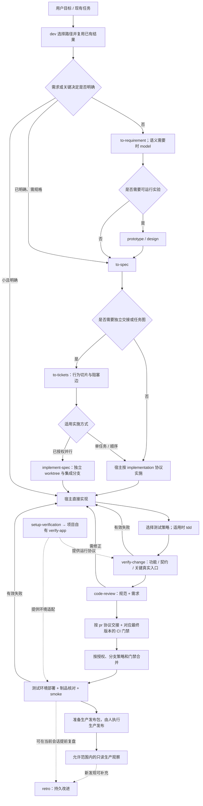

# 以 Matt Pocock 流程为主线的 Skills 整体优化方案

- 初稿：2026-10-18；实施更新：2026-10-19。状态：用户已授权实施，P0/P1 及 P2 可选入口源码、确定性机制演练完成，四平台主干已更新；[实施与证据](2026-10-19-matt-workflow-implementation.md)记录实际范围。P3 业务项目按用户决定稍后选择，模型行为与长期效果不计为已验证。
- 已立即执行的决定：取消“代码合并必须由人执行”；合并遵循用户授权、项目分支策略和必要门禁。生产部署、回滚和生产数据写入的既有人工边界保留。
- 目标：服务小于 10 人团队，从需求、架构与技术方案到任务、实现、功能/E2E、CI、测试环境部署与生产交接形成可恢复的完整流程。
- 参考基线：Matt Pocock skills v1.3.1（发布页提交短号 `24fe0ef`）；核心方法已对照 1.3 系列源码。实施引入前记录完整提交、许可证及本地差异，不跟随浮动 main。
- 替代关系：整体规划替代 [2026-10-13 v3 方案](2026-10-13-ai-dev-flow-skills-redesign.md)；旧方案与 [10 月 14 日实施记录](2026-10-14-ai-dev-flow-implementation.md) 保留历史证据。
- 当前安装事实只以 `config/skills.tsv`、发布器检查及实际链接为准。下列目标清单是职责规划，不是第二份运行 catalog。
- 2026-10-19 审阅结论：采用“implement/pr 先协议、后入口”；补齐快照、引用和迁移契约；复用运行证据但保留独立需求审查；按交接需要选择任务工件，不设固定切片数或 token 阈值。

## 1. 结论与本轮改变

采用 Matt 的阶段划分与交接方法作为研发主干，保留本仓库的业务验证、项目运行适配及数据库专项，将跨部署边界判断融入按需设计参考。普通编辑、工具执行、Git 和调度由宿主承担。

相对 v3 的主要改变：

1. `to-spec` 专注实施规格；任务拆解交给独立的 `to-tickets`，使任务可被另一位成员或另一会话领取。
2. 单任务闭环先采用 `implementation` 协议，由 dev/宿主执行；`implement-spec` 作为 P2 的可选并行入口，不在 P1 提前引入。
3. 恢复有明确方法的 `code-review`：分开检查项目规范与需求符合性；运行验收继续归 `verify-change`。
4. PR 交接先采用 `pr` 协议，新增独立 retro 入口，从实际会话改进检查、导航和工具环境。
5. `dev` 保留为总入口，提供阶段导航和已授权全流程的轻量推进；不再把全部阶段知识堆在入口正文。
6. 代码合并可以由 agent 在已授权范围内执行；区分任务分支集成、受保护主干合并与生产发布。
7. 保留 scan-architecture 的独立体检用途；review-cross-stack-change 降为跨边界设计参考，减少重复评审入口。

本次已实施一项命名调整：原 `to-decision` 更名为 `to-requirement`，突出需求收敛的主要产物。`dev`、`to-spec`、`debug`、`tdd`、`model`、`design`、`review-db`、`to-html` 等既定名称继续保留。

## 2. 流程：Matt 主干 + 我们的验证与交付扩展



图表示依赖与责任，不要求每次经过每个入口。代码审查、快速测试和 CI 可以更早反馈；审查与运行验证没有固定先后，发现缺口后相互补充。implementation/pr 是共享协议，不是当前规划中的独立 skill。复盘可在本次构建结束时进行，不必等待人工生产发布。

Matt 的主线、两种实施方式及复盘位置参考 [ask-matt](https://github.com/mattpocock/skills/blob/v1.3.1/skills/engineering/ask-matt/SKILL.md)。真实业务验证、项目运行协议及生产交接是本地补充，不能归为上游已经提供的完整 CD 能力。

### 2.1 按交接需要选择路径

| 情况 | 最短路径 | 结束依据 |
| --- | --- | --- |
| 小而明确、无需交接 | 宿主直接实现 → 相关验证/审查 → 简短证据 | 已满足本次行为与范围；不生成空 spec/tickets |
| 同一会话连续实施、无需独立交接 | 必要澄清 → to-spec（可内联简短实施顺序）→ 宿主实施 → 验证/审查/PR/CI | 规格足够实施，当前上下文有效，不为流程形式创建 tickets |
| 需多人领取、跨会话恢复或显式管理依赖 | 必要澄清 → to-spec → to-tickets → 宿主按 implementation 协议实施 → 验证/审查/PR/CI | 任务验收闭合、集成结果可检查，未覆盖项明确 |
| 可并行的完整规格 | 已有 spec + 任务图 → implement-spec → 集成验证/审查/PR/CI | 所有必要任务及最终集成版本满足门禁；并行不替代验收 |

需求只到方案时止于方案；用户已授权整项开发时，无需逐阶段重新批准。新的关键业务决定、扩大范围或未授权外部动作单独处理。

不以“切片不超过 3 个”或固定 token 数作为短路径门槛。选择依据是交接、恢复、依赖、责任归属及上下文质量；启用 implement-spec 时必须有明确的任务图。即使只有两项任务，也可能需要独立交接；多项简单行为也可以在同一会话完成。

### 2.2 to-requirement 与后续阶段的边界

`to-requirement` 明确“要解决什么、为什么、为谁、范围与业务验收要求”；`to-spec` 将这些需求变成必要架构、接口、独立验收判据和测试策略；需要可领取的独立实施任务时使用 `to-tickets`。已有明确需求时跳过访谈，不因改名增加文档或审批。

名称按用户选择采用单数 `to-requirement`。需求可以包含多个场景和多项要求，名称不限制条目数。原 skill 的压力测试能力继续作为访谈方法和用户可显式选择的模式：只要求挑战想法、计划或决策时，仅呈现假设、风险、取舍和剩余问题，不强制生成需求文档，也不自动进入技术实现。非软件场景同样按用户目标裁剪。

展示名建议为“澄清需求”，描述突出需求收敛和显式压力测试，避免把普通实施中的局部澄清升级为完整访谈。

## 3. 主流程入口与协议：职责、存在理由与上游映射

| 入口 / 协议 | 与 Matt 的对应 | 输入 → 输出 | 保留此能力的理由 | 边界与动作 |
| --- | --- | --- | --- | --- |
| `dev` | ask-matt + 本地完整交付入口 | 用户目标/当前工件 → 当前阶段、最短路径、交付状态 | 团队无需记住每个入口，恢复任务时不丢验收和授权 | 保留并收窄正文；不成为第二个执行引擎 |
| `to-requirement` | grill-me / grill-with-docs / grilling | 想法/已有材料 → 目标、范围、业务场景、约束及验收要求 | 在技术规格前明确要解决什么、为什么及怎样算满足需求 | 由 to-decision 改名；按需衔接 model；压力测试作为方法和显式模式保留 |
| `prototype` | prototype | 一个可实验的问题 → 可运行实验、结论和证据指针 | 讨论无法回答的状态/交互问题需要实验 | 新增可选入口；逻辑实验与 UI 探索分支，不把原型当生产实现 |
| `to-spec` | to-spec | 已有讨论/决定 → 业务与技术/验收规格 | 固定目标、边界和独立判据，方便交接 | 独立任务工件交给 to-tickets；短路径可内联实施顺序，不维护重复任务状态 |
| `to-tickets` | to-tickets | 规格/明确计划 → 可独立领取的任务与阻塞边 | 任务必须离开原聊天仍能实施和验收 | 新增；每项含交付行为、AC 引用、依赖、测试入口和完成证据 |
| `implementation` 协议 | implement | 单项任务/小规格 → 已实现、已验证、已审查的变更 | 固定“领取到完成”的交接与门禁 | P1 只建立协议，由 dev/宿主复用，不新增 implement skill |
| `implement-spec` | implement-spec | 规格 + 任务图 → 集成分支、任务状态、整体验证 | 并行时有基线、任务所有权、集成与清理的专属约束 | 新增可选入口；无并行条件时降为顺序执行 |
| `code-review` | code-review | 固定比较基线 + 最终变更 + 规格/规范 → 双轴发现 | “代码规范正确”与“实现需求正确”需要分别审查 | 从 retired 状态恢复为有明确方法的入口；不代替运行验证 |
| `pr` 协议 | pr | 最终差异 + 验证证据 → 清晰的审查说明与风险 | 审查需要可检查的变化、证明与恢复边界 | P1 只建立协议，由宿主写 PR 时使用；审查可引用，不新增 pr skill |
| `retro` | retro | 本次会话/运行与审查证据 → 排序后的环境改进候选 | 将重复错误变成检查与可维护规则，而不是不断累积提示词 | 新增；先呈现候选，按已有授权实施，不能自动改全局偏好 |

implementation 的价值是任务交接和完成门禁，pr 的价值是有来源的证据与风险表达。先验证协议可否被 dev/宿主稳定复用；只有出现高价值、独立重复调用的需求，且协议方式确实遗漏行为时，再评估是否新增对应入口。不因上游有同名 skill 就登记两项 active skill，也不以数量直接推导 token 消耗。

上游对照：[规格](https://github.com/mattpocock/skills/blob/v1.3.0/skills/engineering/to-spec/SKILL.md)、[任务](https://github.com/mattpocock/skills/blob/v1.3.0/skills/engineering/to-tickets/SKILL.md)、[单任务实施](https://github.com/mattpocock/skills/blob/v1.3.0/skills/engineering/implement/SKILL.md)、[整规格实施](https://github.com/mattpocock/skills/blob/v1.3.1/skills/engineering/implement-spec/SKILL.md)、[双轴审查](https://github.com/mattpocock/skills/blob/v1.3.0/skills/engineering/code-review/SKILL.md)、[PR](https://github.com/mattpocock/skills/blob/v1.3.0/skills/engineering/pr/SKILL.md)、[复盘](https://github.com/mattpocock/skills/blob/v1.3.1/skills/engineering/retro/SKILL.md)。这些是方法来源，表内存在理由和裁剪为本地设计。

## 4. 现有 Skills 的完整处置

本次读取 catalog 得到 17 个 active 入口；以下逐项说明去向。没有通过规划表自动改变 scope、bundle 或 active 状态。

| 现有 skill | 目标处置 | 在新流程的作用与必要升级 |
| --- | --- | --- |
| `dev` | 保留、轻量化 | 导航及全流程交接；阶段方法放按需协议，明确两种调用模式 |
| `to-spec` | 保留、收窄 | 规格与验收；允许短路径的内联实施顺序；需独立交接的任务图才交 to-tickets |
| `verify-change` | 保留 | 独立预期、相关路径、反向证明、失败分类、证据；与 code-review 分开职责 |
| `setup-verification` | 保留 | 建立/维护目标项目 verify-app；按需增加 local/CI/staging 能力，未跑通 target 明确标记 |
| `to-decision` | 更名为 `to-requirement` | 主要产物为需求契约；保留按需压力测试、已有授权和决定，衔接 prototype/model |
| `debug` | 保留 | 根因未知故障的可证伪反馈循环；修复后可进入 retro，必要时才架构体检 |
| `tdd` | 保留、明确实施衔接 | 实施阶段选择 test-first 后复用 RED/GREEN/REFACTOR；不把所有测试都称为 TDD |
| `review-db` | 保留 | 真实数据库变更的锁、并发、兼容、恢复与环境风险；纯只读不触发 |
| `assess-venture` | 保留可选 strategy | 研发立项前评估新业务/机会；正常工程流程不默认加载 |
| `scan-architecture` | 保留为可选 architecture 专项 | 面向既有系统发现改进候选，不限本次 diff；只读、按需，不作为每项开发的门禁 |
| `review-cross-stack-change` | 退役独立入口，方法转为按需参考 | to-spec 按风险读跨边界设计参考，code-review 检查实现符合性，verify-change 执行相关场景 |
| `model` | 保留、兼容文档名 | 新项目推荐 GLOSSARY.md/GLOSSARY-MAP.md；已有 CONTEXT 约定可继续读取，不维护双份词汇表 |
| `to-html` | 保留可选 docs | 明确要求自包含可打印 HTML 时的产物 helper；与研发主线解耦 |
| `design` | 保留 project | 产品 UI/UX 决策与既有设计约束；与 prototype 协作，区分探索和生产实现 |
| `ui-ux-pro-max` | 保留 project 依赖 | 项目设计的定向知识检索；不成为每个 UI 任务的必经步骤 |
| `impeccable` | 保留 project 依赖 | 有明确方法需求时的设计/审查能力；不重复宿主和其他审查 |
| `show-me` | 保留可选 trial | 用户需要解释图示时使用；pr 借鉴其表达方法，不强行依赖试用 bundle |

计划新增/恢复 5 项入口：to-tickets、code-review、retro（P1），implement-spec、prototype（P2）；implementation/pr 只作为协议。同时退役 review-cross-stack-change 独立入口；改名不改变数量。P1 落实后候选数为 19（17 + 3 - 1），P2 完成后为 21（17 + 5 - 1）。入口数表示维护范围，不意味着每次全部加载。

`code-review` 已有 retired 行：实施时审查旧退役原因，按新职责更新同一 catalog 记录与来源，不追加同名行，不恢复旧的通用提示集合。其他 retired 项保持 retired。

## 5. 关键交接契约

### 5.1 需求、规格与任务分别承载什么

| 工件 | 唯一负责的内容 | 不承担 |
| --- | --- | --- |
| 需求/已确认决定 | 用户价值、范围、业务取舍、目标行为 | 自动根据现有代码定义正确业务 |
| spec | 目标/非目标、BR/AC、必要架构、接口、独立预期、验证与兼容策略 | 重复整段访谈或维护第二份任务进度 |
| ticket | 一项可交付行为、AC 指针、阻塞边、必要上下文、验证入口、完成证据 | 重写 spec、固定将来易漂移的实现文件清单 |
| PR | 实际变化、所满足 AC、运行证据、风险与恢复边界 | 重写需求和全部日志 |
| 运行证据 | 对应版本/制品/环境的实际结果、工件与清理记录 | 因测试绿灯反向批准业务取舍 |
| retro 候选 | 本次问题的来源证据、改进位置、收益、验证与适用范围 | 将每次临时失败变成永久全局禁令 |

首次进入 `to-tickets` 前检查 spec 是否足够实施，缺关键业务决定才返回澄清；范围明确且仅缺分解时直接继续。简单任务可不用正式 spec，已有任务可直接实施。

同一会话连续实施、无独立领取/恢复需要时，spec 可附简短行为切片或实施顺序，直接进入实施；这不是另一份独立任务清单，不重复维护进度。需要跨人/会话交接、显式依赖状态或并行任务图时，再由 to-tickets 生成可领取工件。是否拆分不按任务条数或固定上下文容量决定。

### 5.2 任务与依赖

- 每项切片交付一条可演示或可验证的行为；纯 API/CLI 不强行增加 UI。
- Blocked by 只表示真正阻塞，不把编号顺序当依赖；无阻塞任务组成 ready frontier。
- 任务离开原会话仍具备目标、约束、AC、引用和验证入口；状态与领取人只在选定 tracker 维护。
- 共享类型/接口先明确契约；共享配置与同一文件的大量写入应串行或归一个任务，不以没有显式阻塞边证明可以并行。
- 广泛机械迁移采用 expand–contract；无法逐项保持可用时明确集成分支与最终验收点，不伪造每项均可独立上线。
- GitHub/其他 tracker 与本地 Markdown 是不同存储适配；任务语义一致。既有项目位置优先，不强制 `.scratch` 或某个服务。

### 5.3 单任务实施协议

宿主按 `implementation` 协议确认目标版本、任务、验收、允许范围与测试策略，执行最小可验证行为，完成相关验证和双轴审查，再记录任务结果与交接。dev 可按需读取该协议；单独要求实施时直接复用宿主能力，不要求输入 `$implement`。提交、推送、建 PR、合并分别遵循现有授权和项目策略。

行为明确且适合自动断言时优先考虑 TDD；已有有效回归保护的重构、文档、机械改动和受限环境选择相应策略。选择 TDD 后必须实际看到因目标行为缺失而失败的 RED；其他有效测试不能冒称 test-first。

任务状态区分 implemented、verified、integrated、staging-verified，不能因为子任务完成就宣称整份 spec 已验收。

### 5.4 整份规格并行实施

`implement-spec` 是可选模式，独立存在的约束如下：

1. 只有收到并行实施/委派授权且宿主可用时启动代理；本次“设计方案”不构成实际启动授权。
2. 锁定起始提交与集成分支；先读任务图、接口共享和真实冲突，再确定并发范围与成本预算，不默认追求最大并发。
3. 每个任务有一个所有者、独立 worktree 和基线；采用本次集成分支作为起点。基线错误时重建或安全重定位，不能盲目 reset 用户改动。
4. 子任务携带指针、独立验收、允许范围和公共接口；共享必要原始材料，不复制完整聊天，也不隐去关键决策。
5. 实施者按选定测试策略运行；报告提交、目标 AC、结果与缺口。协调者串行集成，冲突解决后复跑受影响检查。
6. 每次整合后重新计算 ready frontier；最终对实际集成版本执行规格验收、审查及 CI，不把各 worktree 的绿灯相加当集成绿灯。
7. 保存提交与运行证据后，仅清理自己创建、已完成交接的 worktree。取消或失败时保留可恢复状态，不删除用户或其他任务的工作区。

没有代理或 worktree 能力时，可按同一任务图顺序执行并说明模式。并行的可用性、收益和 token 消耗均需实测，不能由任务数推导。

### 5.5 审查与 PR

`code-review` 两个轴分别给结论：

- Standards：项目规范、边界及必要结构判断；工具已确定覆盖的格式问题交给工具。
- Spec：遗漏、部分实现、错误语义和越界行为；规格与变更均固定版本。

verify-change 提供目标版本/制品、工作树变更、配置与环境标识、AC 到场景的映射，以及 PASS、FAIL、NOT_RUN、BLOCKED 等实际结果和工件；失败原因未知时如实标明。code-review 复用这份证据，不默认重复运行相同且仍有效的检查，但不能把 PASS 当成免审依据。

Spec 轴继续独立对照需求与实际实现，包括已 PASS 场景的断言是否充分、未测路径是否改变结论、角色/数据/版本是否符合验收，以及范围外修改。测试遗漏或测试预期错误仍属于审查目标，不能把 Spec 轴缩减为只检查 NOT_RUN 项；Standards 轴仍独立报告规范和结构判断。

版本、配置或环境变化，或发现新缺陷、断言缺口与相反证据时，才补充受影响的运行检查。审查可早于、晚于或与运行验证交错开展；高风险独立审查可以先形成判断再对照测试结果，减少证据表对判断的锚定。

审查基线、HEAD 和工作树状态需明确；空 diff 返回 no-op。缺 spec 时可用任务中的独立需求，仍不足则标出缺口，不补写一个与实现自洽的 spec。高风险且获授权时可以独立代理分别检查；普通改动允许同一审查者分轴执行并报告独立性限制。

`verify-change` 是运行判定，不与上述任一轴混为一谈。重大遗漏不能被“规范通过”抵消；审查通过不能代替真实验收。

`pr` 协议优先遵守仓库模板，适用内容为：最短变化说明（必要图示）、前后或正反证据、目标 AC、影响范围、可逆性、迁移与恢复条件、未验证项。截图用于视觉事实，数据/权限行为需要实际业务断言。CI 工件引用真实地址或文件，不编造已上传链接。该协议由 dev/宿主写 PR 时使用，code-review 可引用其证据与风险，不增加固定的 skill 切换。

### 5.6 架构扫描与跨边界设计参考

`scan-architecture` 保留为独立可选专项，回答“现有系统哪里值得改进”：扫描范围可以超过本次变更，输出深模块、局部性、耦合与测试缝的候选及优先级。发现候选后再按需要进入 to-requirement/to-spec；code-review 仍围绕实际变更审查，不自动扩大为全库体检。

`review-cross-stack-change` 的方法在实施时迁入 `docs/workflow-protocols/cross-boundary-design.md`，作为唯一维护位置。满足以下实际风险之一才读取，不因同时改了前后端就机械触发：

- 多个可部署单元需要版本共存，API/事件/schema 变化影响旧消费者。
- 异步消息、重试、部分成功或补偿使状态归属与失败语义不明确。
- 迁移、缓存失效、离线状态或发布顺序存在兼容与恢复耦合。
- 信任边界、身份或租户隔离跨进程传播，存在权限责任缺口。

to-spec 读取相关部分，将责任归属、兼容/失败契约和可验证场景写入规格；code-review 对照这些决定检查实现及遗漏；verify-change 运行相关成功、拒绝、版本错配或恢复路径。职责分别是设计、审查和运行判定，不重复生成三份完整评审报告。

共享参考只保留能改变判断的边界方法，不搬入全部通用检查清单。真实数据库操作继续由 review-db 评估，领域语义由 model 澄清。用户要求只审查方案时，宿主直接按该参考审查，不先补写整份 spec。将来若跨团队独立方案评审成为高频需求，再凭使用证据决定是否恢复入口。

## 6. 整体测试、CI 与 CD

测试能力是本方案对 Matt 主线的必要扩展。按业务后果和影响范围选择层级，不要求每个 AC 都写五套测试。

| 层级 | 谁负责 | 什么算有效证据 |
| --- | --- | --- |
| 静态检查/类型/构建 | 宿主执行项目现有命令 | 目标版本的实际退出结果；不等于业务验收 |
| 功能/局部回归 | 宿主按实施协议执行，适用时 tdd | 公共行为断言；关键修复可证明测试检出原缺陷 |
| 契约/集成 | 宿主实施 + verify-change | 真实内部链路、边界契约及必要数据库/队列副作用 |
| 关键真实入口/E2E | verify-change + verify-app | 独立判据、正确角色与前置数据、真实操作、副作用与证据 |
| CI | 项目流水线 | 本次提交/合并结果对应的必要检查、制品与失败工件 |
| 测试环境部署 | 已授权流水线/工具 | 明确制品、启动/健康、版本核对及相关 smoke |
| 生产交接 | dev/宿主汇总，PR 按协议引用 | 审查、CI、测试环境结果、迁移兼容、恢复、观察与剩余风险 |
| 生产部署/回滚/数据写入 | 人 | 人的执行记录；agent 仅在允许范围内只读观察 |

保留现有 Doctor、隔离 Data、Drive、Observe、Evidence、Cleanup、Targets 协议。CLI/脚本足够就使用已有入口；有真实缺口再引入 MCP。账号与数据访问依项目事实确定，不能用“已安装 skill”代替访问条件。

关键修复或新测试的反向证明在隔离副本/worktree 复现旧 bug 或针对性变异；语法/环境错误不是业务 RED。已有效证明的测试不每次重复变异。CI 选择可以稳定重复的断言，探索发现稳定问题后固化回归。

失败分类为产品、测试、夹具、环境或未知；保留实际结果和未运行项。不能通过删除正确断言、扩大 skip 或盲目重试达到门禁。项目设施暂缺时，可交付 implemented/blocked，不能宣称 staging-verified。

## 7. 合并与授权：立即生效的更新

取消全局“合并必须由人执行”的规则。执行者可以是 agent，也可以是人，取决于用户授权、项目分支策略及必要门禁，而不是全局身份限制。

| 动作 | 更新后的执行条件 |
| --- | --- |
| 任务分支合入本次集成分支 | 已授权该实施/集成范围，明确基线与归属，相关检查通过；agent 可执行 |
| 创建/更新 PR 或推送远端 | 复用明确授权与项目约定；不因允许本地合并就推导出任意外部写权限 |
| PR 合入主干/受保护分支 | 用户已授权到该目标，满足项目审查、CI 与分支保护；agent 可执行，不绕过平台限制 |
| 冲突解决 | 检查真实冲突与业务含义，解决后验证对应最终结果；不因此一律要求人工 |
| 测试部署 | 遵循既有授权和流水线门禁，核对实际制品 |
| 生产部署、回滚、生产数据写入 | 本轮未解除既有人工边界 |

取消身份限制不构成对任意仓库/分支的永久合并授权；已有明确授权也不因切换阶段重复询问。项目仍要求人工审查时遵守项目约定，不把新全局规则解释为覆盖分支保护。

本轮立即修改 `rules/AGENTS.md`、dev、setup-verification、共享产物契约及 README，清理运行入口中的旧约束。旧报告保留当时事实并标记被新决定替代。其他新技能仍是规划。

## 8. 调用设计：阶段入口与可复用协议

### 8.1 两种用户使用方式

- 自主选择阶段：显式使用 to-requirement、to-spec、to-tickets、implement-spec、retro，结束在所请求的阶段；实施单项任务和写 PR 直接请求宿主，按相关协议完成。
- 授权完整交付：显式使用 dev 并给出目标与范围；dev 复用当前阶段协议并由宿主推进，阶段切换不再逐项请求用户输入相同指令。生产操作边界仍然有效。

Matt 将人工阶段入口与可被模型选用的专项分开。我们保留这一区别，但增加“用户已请求完整交付”的入口，以满足原始需求；这是本地扩展，不声称上游 ask-matt 会自动执行全流程。

### 8.2 解决当前的调用歧义

当前 dev/to-spec/verify-change/setup-verification 的元数据均为显式调用，dev 正文又提及后三者。单纯出现名称不能证明实际加载成功；也不能假设每个宿主都有相同的 Skill 工具。

计划将阶段可复用方法放入 `docs/workflow-protocols/`：requirements、spec、tickets、implementation、review、pr、retro；跨边界设计参考由实际风险触发。SKILL.md 统一通过自身 `references/<protocol>.md` 访问，具体链接契约见下文；原 `docs/delivery-artifacts-spec.md` 保留产物与运行证据的权威定义，不复制一份。

权威源保留在 docs，skill 目录内建立相对符号链接，正文只写 `[协议名](references/<protocol>.md)`。按当前第一方目录层级，示例为：

```text
global/specialists/dev/references/implementation.md
  -> ../../../../docs/workflow-protocols/implementation.md
```

`global/helpers/<skill>/references/` 在当前层级同样需要四层 `..`。实施时从链接所在目录计算相对目标并验证，不将示例层数套用于任意深度的 vendor 目录。SKILL.md 不直接写越出 skill 根目录的 `../../../docs/...` 路径，避免宿主先按逻辑路径归一化造成错位。

- SKILL.md 保存触发、输入、停止点和相关协议指针；正文与协议不双向重复同一方法。
- 明确用户选择的阶段入口保持显式调用。完整交付授权下，dev 直接读取所需阶段协议，不假装调用了宿主禁止隐式调用的入口。
- code-review 与现有领域专项可在匹配任务时供模型选择；implementation/pr 是按需参考，不登记独立元数据。verify-change/setup-verification 在实施时明确预期调用方式后同步元数据，本轮不悄悄修改调用策略。
- 跨平台使用可用的文档读取/skill 机制；某一机制不可用时读取对应协议，仍受用户原始授权和阶段停止点约束。
- 在临时发布入口下逐个读取 references 链接，并与权威源逐字节比对；检查失效链接、目录移动与深度变化。文件系统可读与宿主实际按指针加载是两层证据，四个平台分别做最小调用检查，不能把 openai.yaml 存在当各平台均支持该策略的证明。

### 8.3 为什么需要独立入口而不是只有一个大 dev

单独入口允许只产规格、只拆任务、只审查或只复盘；共享协议避免 dev 复制所有正文。入口只提供稳定职责和交接，循环、工具执行和内部任务队列仍使用宿主能力。

初次进入项目时，复用 AGENTS、构建脚本、CI、现有 tracker 和文档约定。只有稳定且无法从一处配置读取的约定需要持久记录，可使用项目已有文档或 `docs/agents/workflow.md` 指针页。无需新建强制 setup-workflow skill，不在全局规则存项目命令清单。

## 9. 第三方来源与目录规划

新增能力先按固定快照进入 ai-skills，经过核对后再发布，不能直接装入用户目录。

推荐采用“固定原文 + 第一方适配”的一种模式：

1. 将完整上游参考快照保存在 `vendor/mattpocock/`，记录固定版本、完整提交、来源与许可证，保留原始 SKILL.md 与辅助文件；不登记 catalog，不直接发布整包。该目录属于外部社区参考，不进入 doctor 对运行 skill 根目录的递归元数据校验。
2. 我们选用并修改的执行入口放在 `global/specialists/`，方法协议放在 `docs/workflow-protocols/`。记录来源、上游文件、许可要求及本地差异。上游原文不跟随本地改名。`vendor/global-skills/` 用于实际作为受管全局入口发布的第三方快照，不作为本轮完整参考仓库的存放位置。
3. catalog 只登记实际执行入口，避免原文快照和适配版本同时 active。未来升级通过 diff 比较并重新验证，不混入未审阅的 main。
4. 上游运行依赖逐项改写：grilling → 由现有 to-decision 迁移出的 to-requirement 需求/访谈协议，domain-modeling → model，codebase-design → 共享架构判断参考，writing-for-agents → 按需编写参考。没有采用的依赖不留下不可执行的裸名称。
5. 保留 pr 对 show-me 的归属链；不因复用图示方法把可选 trial 变为必装依赖。
6. 随入口分发的引用遵循 §8.2 的 skill 内 references 链接契约，并验证发布入口可读；不依赖作者机器的绝对路径，也不把文档引用误登记为安装依赖。

目录名、frontmatter、元数据及 `$name` 一致，现有 retired 历史继续保留。只有运行时硬依赖进入 catalog 的 dependencies；流程先后、候选关系和方法来源不等于安装依赖。

## 10. 分阶段实施与发布

| 阶段 | 改动 | 完成条件 |
| --- | --- | --- |
| P0：本轮即时修正 | 取消强制人工合并，清理活跃规则与协议；产出本方案 | 仓库检查、适用 skill 测试、实际规则同步及 --check |
| P1：主干交接 | 固定上游参考快照；to-decision 改为 to-requirement；退役跨栈评审入口并保留参考；增加 to-tickets/code-review/retro；实施与 PR 先协议化；轻量化 dev | 短路径和独立交接路径均可执行，证据复用但审查不免除 PASS 场景，阶段单用与全流程调用均不越界 |
| P2：并行与实验 | 增加 implement-spec/prototype；完善基线、冲突、清理与实验归档 | 至少两个可并行任务和一个有真实依赖任务的隔离演练；失败可恢复，整体验证对应集成版本 |
| P3：业务试点 | 选择一个实际项目接 verify-app、CI 和测试部署 | 关键业务正常/拒绝/失败路径、实际制品与清理有证据；生产仅交接 |
| P4：精简与定稿 | 根据 retro 和固定场景评估删除无效入口/正文，决定默认 bundle；再评估协议是否确需独立入口 | 有独立重复调用的价值及行为证据才升级入口；低调用且并入 dev 不丢门禁的入口收回协议，记录正确性和实际成本 |

建议 P1 在现有可选 flow 中增加三项（to-tickets、code-review、retro），连同现有四项形成七个主干/验证入口；implementation/pr 只作为相关入口可读取的协议。P2 的 implement-spec 与 prototype 分别作为可选并行/探索 bundle，不因方法复杂而提前加入 P1，也不自动加入所有平台。最终名称、scope、bundle、依赖在实施时只写入 catalog；本节不作为发布器输入。

默认 core 不自动扩大。现有 architecture/docs/strategy/ui/trial 继续按需，用户此前确认的命名与第三方快照保留。新方案获认可后，再确定实际安装范围并复用已有目标，不对所有业务项目批量改写 AGENTS。

### 10.1 改名与退役的实施顺序

1. 先提取跨边界参考，再将 dev、to-spec、model、审查协议等调用点从旧入口改为条件引用；保留必要证据和判断，不把退役等同于删除知识。
2. 将 to-decision 源码目录、frontmatter、元数据中的 `$name`、活跃引用及巡检/发布测试统一迁为 to-requirement；不同时发布两份同义入口。
3. catalog 保留 to-decision 与 review-cross-stack-change 的 retired 记录，source 为 `-`；新增 active 的 to-requirement，保留原 core 归属。其他依赖不能继续指向退役入口。
4. 明确更新 `scripts/doctor.sh` 的 required_paths：替换 `global/specialists/to-decision/SKILL.md`，移除退役的 `global/specialists/review-cross-stack-change/SKILL.md` 路径，补入实际需要的协议检查。同步 `tests/publish-skills-test.sh`、README、产物契约、dev/model/assess-venture 等活跃引用，扫描 adapters 中的命令适配；没有旧引用的文件不作机械修改。历史方案/报告保留原名并指向新规划。
5. 在 `tests/publish-skills-test.sh` 明确增加两种旧受管链接（含 dangling 链接）的清理断言，验证 to-requirement 新入口、完整依赖闭包、非受管实体/外部链接保护，以及冲突时不提前清理旧入口、不留下部分迁移；按 §8.2 验证跨边界及其他协议从临时发布链接可读。
6. 按已确认目标重新发布并 --check，说明需要会话重新加载。上述迁移已在本仓库及已授权四平台主干完成；正文保留设计约定语气，实际检查与未覆盖范围见实施记录。其他业务项目不在本轮批量迁移范围。

## 11. 验证与验收

结构测试不能代替模型行为和真实业务验证。不同层分别报告：

| 场景 | 必须观察的结果 |
| --- | --- |
| 明确小改动 | 直接实施相关验证，不生成 spec/tickets，不启动多代理 |
| 中等需求、同会话连续实施且无需交接 | to-spec 可内联简短实施顺序，直接由宿主实施，不强制创建 tickets 或调用 implement/pr skill |
| 需要交接或并行 | 根据责任、依赖和恢复需要生成任务工件；并行模式有明确任务图，不按切片数或 token 阈值判断 |
| 只要求规格 | 产出独立 AC 与必要方案；不擅自实施、推送或合并 |
| 需求澄清/显式压力测试 | to-requirement 按请求产出需求或风险判断，复用已确认内容；不因改名强制写文档或实施 |
| 跨部署兼容风险 | to-spec 实际读取条件参考并形成契约/场景；审查与验证分别对照，不要求旧评审入口 |
| 单独拆任务 | 复用已有规格，任务可独立领取，阻塞边真实，无重复需求访谈 |
| 已授权完整交付 | dev 实际读取相关协议并推进，不要求用户逐阶段重输相同授权 |
| 普通功能 | 单项行为循环、真实验证、双轴审查、版本对应的 PR/CI 证据 |
| 测试 PASS 但断言不充分 | code-review 的 Spec 轴仍能指出断言、未测路径或数据/权限语义的缺口，不以 PASS 免审 |
| 已充分覆盖的运行检查 | 同版本、工作树、配置及环境无相关变化时复用证据，不重复运行整套检查；新疑点只补相关路径 |
| 并行任务图 | 只启动 ready 任务，工作区隔离，冲突后重新验证最终集成版本 |
| 允许自动合并 | 有目标授权且门禁满足时可合并；项目保护规则仍被遵守 |
| 没有目标分支授权 | 完成可独立进行的实现/审查，不把取消身份限制当任意合并权限 |
| 权限/租户隔离回归 | 真实入口与副作用断言；隔离错误版本确因业务错误失败 |
| CI 或测试环境失败 | 保留失败工件和未运行项，不将 implemented 写为 staging-verified |
| 复盘 | 从会话证据提出改进，机械错误优先补确定性检查，不自动增加全局禁令 |
| 四平台安装 | 入口发现、显式阶段、专项加载、协议引用、旧链接清理逐项实测 |

常规仓库检查包括 doctor、差异检查、skill 元数据校验、发布器测试、HTML 测试、verification-flow-test.py 及 shell 语法。修改发布选择或依赖行为时增加对应隔离测试，不用真实用户目录发布代替测试。

模型行为评估采用独立任务/固定快照，记录实际读取、命令、工件及结果；有授权才使用评估子代理。样例通过不证明团队提效，多个模型同意不证明验收正确。当前 6 项 HTTP/SQLite 测试仅证明已有验证协议样例，不能冒充新 to-tickets/implement-spec 的执行验证。

## 12. 尚需业务项目确定的事实

实施进入目标项目时优先自行查证，不能查证且影响结果时再询问：

- 任务与规格载体、团队角色和领取/关闭规则。
- 分支拓扑、允许自动集成的目标、PR 审查及 CI 门禁、远端操作授权。
- 测试账号、租户与数据隔离、外部依赖、E2E 工具、证据保留与清理方式。
- 测试部署入口、制品标识、smoke、恢复条件及生产交接负责人。
- 并行上限和预算，何时继续上下文、交接或压缩。

这些是项目事实，不是要求用户现在回答的一组新问题。推荐先完成 P1 的可审查实现，再用一个真实项目验证完整闭环。

## 13. 证据与来源边界

已核实：当前 catalog/源码、现有调用元数据、Matt 1.3 系列核心方法与 v1.3.1 发布；代码合并限制由用户本轮明确取消。上游作者的个人使用经验与本团队效果分别看待。

本轮 P0 核验：doctor、发布器测试、HTML 测试、6 项 HTTP/SQLite 回归、变更 skill 结构校验、既定 shell 语法与差异检查通过。新规则已同步 Codex、Claude Code、Antigravity、Gemini；四平台 --check 通过，三个实际规则文件（后两者共用 GEMINI.md）与源码逐字节一致。这是 P0 的历史核验；后续 P1/P2 源码与机制演练结果见 2026-10-19 实施记录，不能由确定性测试推断模型行为或团队收益。

已实施：新增/恢复五项入口与实施/PR 协议，完整提交与许可来源已固定。仍待验证：真实模型执行质量、四宿主行为、并行收益、业务项目 E2E/CI/CD、token 与交付成本；确定性机制结果不冒充上述试点。

补充来源：[v1.3.1 发布记录](https://github.com/mattpocock/skills/releases/tag/v1.3.1)、[编写 agent 文档的方法](https://github.com/mattpocock/skills/blob/v1.3.0/skills/productivity/writing-for-agents/SKILL.md)。减少无效指令、明确条件指针和按需读取属于可借鉴方法，实际删减需有行为证据。
